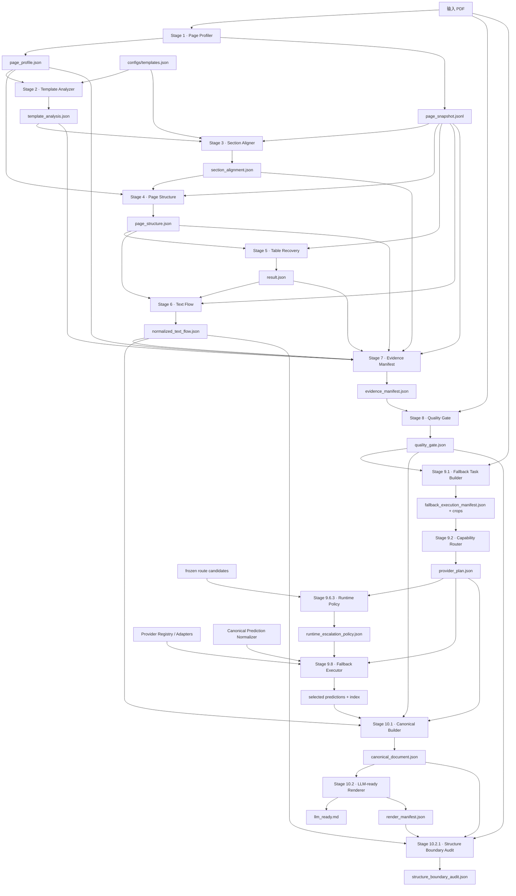

# PDFFast v2 迁移方案

状态：设计已批准；Phase 0–1 已完成并验证；Phase 2A（Stage 7–8）已完成
日期：2026-09-20
旧工程（只读行为基线）：`/Users/admin/Workspace/pdffast`
新工程：`/Users/admin/Workspace/pdffast-v2`

## 实施状态

| Phase | 状态 | 验证 |
|---|---|---|
| Phase 0：基线冻结与测试骨架 | 完成 | 默认套件 21 passed / 3 skipped；绑定 reference 的 contract 套件 7 passed |
| Phase 1：Native Pipeline | 完成 | Stage 1–6 已迁移；真实样本十九项 Artifact 字节级一致 |
| Phase 2：Quality 与 Fallback Planning | 进行中 | Stage 7–8 已迁移并完成真实样本逐文件等价回归；Stage 9 planning/policy 待迁移 |
| Phase 3：Provider Runtime | 计划中 | 尚未迁移 Provider adapter |
| Phase 4：Canonical、Renderer、Audit | 计划中 | 尚未迁移业务算法 |
| Phase 5：性能优化 | 计划中 | 必须等待 Phase 1–4 等价回归通过 |

## 1. 目标与非目标

### 1.1 目标

建立一个新的、可独立发布的 Python 工程，将任意 PDF 解析为供下游 AI 使用的 Markdown：

```text
PDF -> PDFFast Parser -> outputs/<run-id>/10_2_llm_ready/llm_ready.md
```

新工程应做到：

1. 保留旧工程当前生产 Pipeline 的算法行为与 Artifact 语义；
2. 按职责组织代码，不再以 Stage 编号命名业务模块；
3. 让 Provider adapter、Fallback runtime、Canonical normalization 相互解耦；
4. 统一路径、JSON、哈希及严格等价的几何/文本公共操作；
5. 建立新旧工程的逐 Artifact 回归比较能力；
6. 为 Provider 复用、缓存、批处理和安全并发预留架构，但不在纯迁移阶段改变算法结果；
7. 提供一个普通用户无需理解内部 Stage 的生产入口。

### 1.2 非目标

第一版不做以下工作：

- 不开发 PDF 下游智能评审；
- 不重新训练、评测或挑选 Provider；
- 不修改算法阈值、Quality Gate、Provider 顺序或 runtime escalation；
- 不用 Ground Truth、DEV 标签或 holdout 结果参与 runtime；
- 不增加 case、page 或固定字符串特判；
- 不根据模板补写 PDF 中不存在的内容；
- 不迁移完整 benchmark、Ground Truth、holdout 和调参工具链；
- 不自动复制真实 PDF，也不将真实 PDF 加入 Git；
- 不在第一轮迁移中追求性能数字提升。

## 2. 迁移策略

采用已批准的“行为锁定、纵向切片迁移”策略。

迁移顺序不是一次性拆完 57,985 行生产代码，而是：

1. 冻结旧工程源文件和配置的校验和；
2. 先建立 Artifact 契约与新旧比较器；
3. 分四个纵向切片迁移；
4. 每个切片通过回归后再继续；
5. 所有切片等价后，才启用独立的性能优化阶段。

迁移算法时遵守以下约束：

- 首次搬迁尽量保持常量、分支、循环顺序和函数体不变；
- 允许改变文件归属、函数入口、依赖注入方式和 CLI 包装；
- 只合并经测试证明语义完全一致的公共函数；
- 对大型模块先建立清晰的公开边界，再逐步做内部拆分；
- 任何新旧输出差异默认视为迁移缺陷，除非有明确证据证明仅是允许忽略的运行元数据。

## 3. 当前生产依赖图



### 3.1 关键依赖边界

- Stage 1 和 Stage 9.1/8 是生产链中需要重新访问 PDF 的位置；Stage 2–7、9.2、9.6.3、10.x 应仅消费 Artifact。
- Stage 7 是 evidence accounting，不是质量裁决；Stage 8 才负责 Quality Gate。
- Stage 9.2 只做 capability routing，不绑定 Provider。
- Stage 9.6.3 根据冻结策略为当前任务实例化 provider chain。
- Stage 9.8 负责执行、升级与选择；Provider 不拥有升级策略。
- Stage 10.1 是 Native 与 Fallback 的唯一正式合并点。
- Stage 10.2.1 是生产完成条件的一部分，不能只作为人工工具保留。

## 4. 旧工程生产文件清单

以下文件包含当前生产路径的直接逻辑，应迁移其生产职责：

| 旧文件 | 行数 | 生产职责 | 迁移方式 |
|---|---:|---|---|
| `scripts/1_page_profiler.py` | 2,710 | 单次 PDF 扫描、页面画像、Raw Evidence Snapshot | 主体迁移 |
| `scripts/2_template_analyzer.py` | 1,470 | 模板检测 | 主体迁移 |
| `scripts/3_section_aligner.py` | 3,193 | 模板/通用章节对齐 | 主体迁移 |
| `scripts/4_page_structure_builder.py` | 6,087 | 页面块、复杂度、跨页线索 | 主体迁移 |
| `scripts/5_table_recovery.py` | 5,061 | 页内与跨页表格恢复 | 主体迁移 |
| `scripts/6_text_flow_normalizer.py` | 21,290 | 噪声、阅读顺序、段落、跨页正文、最终 Native Flow | 主体迁移，风险最高 |
| `scripts/7_native_evidence_manifest.py` | 2,004 | Native evidence ledger/accounting | 主体迁移 |
| `scripts/8_quality_gate.py` | 1,816 | 页面/区域质量门和 raster probe | 主体迁移 |
| `scripts/9_1_fallback_unit_builder.py` | 349 | Fallback 任务和裁剪输入物化 | 主体迁移 |
| `scripts/9_2_provider_router.py` | 365 | Capability routing | 主体迁移 |
| `scripts/9_6_3_runtime_escalation_policy.py` | 784 | 冻结策略实例化 | 主体迁移 |
| `scripts/9_8_full_production_fallback_executor.py` | 1,045 | Provider wave、升级、选择、终止语义 | 主体迁移 |
| `scripts/9_3_provider_benchmark.py` | 4,215 | 同时含 Provider runtime 与 benchmark | **只提取 runtime/adapter/worker 部分** |
| `scripts/9_5_1_prediction_normalizer.py` | 3,234 | 各 Provider 原始结果标准化 | 生产职责迁移 |
| `scripts/10_1_canonical_document_builder.py` | 931 | Native/Fallback 合并 | 主体迁移 |
| `scripts/10_2_llm_ready_renderer.py` | 1,527 | Markdown 渲染与 manifest | 主体迁移 |
| `scripts/10_2_1_structure_boundary_audit.py` | 767 | 结构边界审计 | 主体迁移 |
| `scripts/pipeline_observed_runner.py` | 1,137 | 编排、路径、日志、运行报告 | 按新 Pipeline API 重建 |

生产配置：

| 旧配置 | 新位置 | 约束 |
|---|---|---|
| `configs/templates.json` | `configs/templates.json` | 迁移时保持内容一致 |
| `configs/stage9_providers_v011.json` | `configs/providers.json` | 生成生产子集；保留 Provider 的配置对象逐字段不变，删除未迁移的 Surya/Tesseract/generic CLI 条目 |
| `configs/frozen/stage9_route_candidates_prod_v001.json` | 同名目标文件 | 必须 byte-for-byte 一致 |

基线校验和：

```text
templates.json
a3c50aafa43c2afece508b27ff9204b47bdf6a0d145547beb22fb3fd4fb546b1

旧工程 stage9_providers_v011.json（迁移来源基线）
dbad7df98a65a3da918f38cb12353e86d237131ec8d9180c41a92cf0de2256af

新工程 providers.json（已确认的生产 Provider 子集）
2c8aca69d5d3f564d8282b64cc6513e008d829f3debd660afb1ef6361936f79a

stage9_route_candidates_prod_v001.json
0d999777e130de54ff25248c02cf39ae37e9fe7c5ef9231650aa3304008772d3
```

冻结路由文件已确认与旧 DEV 产物
`outputs/9_6_route_candidates/case_006_dev_v011/route_candidates.json`
逐字节一致。

## 5. 明确不迁移的文件

### 5.1 研发、Ground Truth、评估与 Holdout

以下脚本不进入生产 package：

```text
scripts/9_4_1_quality_sample_selector.py
scripts/9_4_2_quality_review_index.py
scripts/9_4_3_ground_truth_builder.py
scripts/9_5_0_evaluation_spec_builder.py
scripts/9_5_2_quality_evaluator.py
scripts/9_6_1_route_benchmark_aggregator.py
scripts/9_6_2_route_candidate_selector.py
scripts/9_6_4_policy_replay_validator.py
scripts/9_7_0_prepare_cross_case_holdout_inputs.sh
scripts/9_7_1_cross_case_fallback_catalog.py
scripts/9_7_2_holdout_selector.py
scripts/9_7_3_holdout_provider_plan_builder.py
scripts/9_7_4_holdout_gt_review_package.py
scripts/9_7_5_holdout_gt_freeze_builder.py
scripts/9_7_6_holdout_evaluation_spec_builder.py
scripts/9_7_7_cross_case_generalization_report.py
scripts/run_full_third_party_benchmark.py
scripts/run_final_benchmark_1_8.py
scripts/run_stage1_6.sh
```

第一版也不迁移相应配置：

```text
configs/quality_*.json
configs/review_tasks_*.json
configs/provider_bindings_v010.json
```

如未来确需恢复离线研发能力，应建立独立的 `tools/benchmark/` 包，并确保生产 package 不依赖它。

### 5.2 历史产物和本地环境

不迁移：

```text
outputs/**
benchmark/reports/**
benchmark/manual_review/**
.venv/**
.venv-docling/**
.venv-marker/**
.venv-mineru/**
.venv-surya/**
.idea/**
__pycache__/**
time
```

真实 PDF 由用户人工放入新工程 `benchmark/samples/`，默认被 `.gitignore` 排除。

### 5.3 首版不迁移的 Provider

已确认首版不迁移：

- Surya；
- Tesseract；
- generic CLI。

保留的 Provider 范围：

- RapidOCR；
- PaddleOCR Text/mobile；
- PaddleOCR-VL；
- PP-Structure；
- MinerU；
- Marker；
- Docling。

注意：冻结 runtime policy 会引用保留配置中可能标记为 `enabled: false` 的 Provider（例如 Marker、MinerU）。显式 provider chain 的行为必须按旧 runtime 保留；不能在迁移时借机改变 enabled 解释、provider chain 或失败语义。Surya、Tesseract、generic CLI 的配置条目与 adapter 一并不进入新工程。

## 6. 新工程目录

```text
pdffast-v2/
├── pyproject.toml
├── README.md
├── .gitignore
├── pdffast/
│   ├── __init__.py
│   ├── cli.py
│   ├── core/
│   │   ├── json_io.py
│   │   ├── paths.py
│   │   ├── hashing.py
│   │   ├── numbers.py
│   │   ├── geometry.py
│   │   └── text.py
│   ├── native/
│   │   ├── profiler.py
│   │   └── text_flow/
│   │       ├── __init__.py
│   │       ├── noise.py
│   │       ├── reading_order.py
│   │       ├── paragraphs.py
│   │       ├── cross_page.py
│   │       └── materialize.py
│   ├── template/
│   │   ├── detector.py
│   │   └── aligner.py
│   ├── structure/
│   │   ├── page_structure.py
│   │   └── table_recovery.py
│   ├── quality/
│   │   ├── evidence_manifest.py
│   │   └── gate.py
│   ├── fallback/
│   │   ├── task_builder.py
│   │   ├── router.py
│   │   ├── policy.py
│   │   └── executor.py
│   ├── providers/
│   │   ├── base.py
│   │   ├── registry.py
│   │   ├── rapidocr.py
│   │   ├── paddleocr.py
│   │   ├── docling.py
│   │   ├── mineru.py
│   │   ├── marker.py
│   │   └── workers/
│   │       ├── protocol.py
│   │       ├── docling_worker.py
│   │       ├── mineru_worker.py
│   │       └── marker_worker.py
│   ├── canonical/
│   │   ├── prediction.py
│   │   ├── normalizer.py
│   │   └── builder.py
│   ├── render/
│   │   └── llm_ready.py
│   ├── audit/
│   │   └── structure_boundary.py
│   └── pipeline/
│       ├── artifacts.py
│       ├── context.py
│       ├── runner.py
│       ├── cache.py
│       └── observability.py
├── configs/
│   ├── templates.json
│   ├── providers.json
│   └── frozen/
│       └── stage9_route_candidates_prod_v001.json
├── scripts/
│   └── run_pipeline.py
├── tests/
│   ├── fixtures/
│   │   └── artifacts/
│   ├── unit/
│   ├── contracts/
│   ├── integration/
│   └── regression/
├── benchmark/
│   └── samples/
├── docs/
│   ├── ARCHITECTURE.md
│   ├── PIPELINE.md
│   ├── MIGRATION.md
│   └── MIGRATION_PLAN.md
└── outputs/
```

`native/text_flow/` 使用子包而非一个新的 21,000 行文件，但拆分必须发生在 Characterization Test 之后。公开入口只暴露一个 Text Flow 操作，内部子模块不被 Pipeline 直接调用。

## 7. 新旧文件映射

| 旧实现 | 新实现 | 说明 |
|---|---|---|
| `1_page_profiler.py` | `pdffast/native/profiler.py` | 保留一次打开 PDF 的行为 |
| `2_template_analyzer.py` | `pdffast/template/detector.py` | 模板配置通过参数注入 |
| `3_section_aligner.py` | `pdffast/template/aligner.py` | 同时显式接收 snapshot |
| `4_page_structure_builder.py` | `pdffast/structure/page_structure.py` | Stage metadata 留在输出，不进入文件名 |
| `5_table_recovery.py` | `pdffast/structure/table_recovery.py` | 保留表格 authority 与跨页规则 |
| `6_text_flow_normalizer.py` | `pdffast/native/text_flow/*` | 先整体表征测试，再按子职责拆分 |
| `7_native_evidence_manifest.py` | `pdffast/quality/evidence_manifest.py` | 保留 accounting/quality 边界 |
| `8_quality_gate.py` | `pdffast/quality/gate.py` | 阈值与判断顺序冻结 |
| `9_1_fallback_unit_builder.py` | `pdffast/fallback/task_builder.py` | 只构建任务和图像输入 |
| `9_2_provider_router.py` | `pdffast/fallback/router.py` | 只路由 capability，不绑定 provider |
| `9_6_3_runtime_escalation_policy.py` | `pdffast/fallback/policy.py` | 冻结 provider chain 和升级条件 |
| `9_8_full_production_fallback_executor.py` | `pdffast/fallback/executor.py` | 管理 wave、状态和终止语义 |
| `9_3_provider_benchmark.py` 的 runtime 部分 | `pdffast/providers/*` | 删除 benchmark 报表、抽样和 provider 对比职责 |
| `9_5_1_prediction_normalizer.py` | `pdffast/canonical/normalizer.py` | Provider raw -> canonical prediction |
| `10_1_canonical_document_builder.py` | `pdffast/canonical/builder.py` | 保留 provenance merge |
| `10_2_llm_ready_renderer.py` | `pdffast/render/llm_ready.py` | Markdown 字节级回归 |
| `10_2_1_structure_boundary_audit.py` | `pdffast/audit/structure_boundary.py` | 默认随生产 Pipeline 执行 |
| `pipeline_observed_runner.py` | `pdffast/pipeline/*` | 重新建立 Context、Artifacts、Runner、Observability |

CLI `scripts/run_pipeline.py` 只负责参数解析和调用 `pdffast.pipeline.runner`，不包含业务逻辑。

## 8. PipelineContext 与 ArtifactPaths

### 8.1 职责

`PipelineContext` 保存单次运行的稳定上下文：

- 输入 PDF；
- project root、output root、run directory；
- case ID、run ID；
- templates、providers、frozen policy 路径；
- page/region DPI 和明确的运行参数；
- `ArtifactPaths`；
- 日志与 observability sink；
- 可选的 Artifact cache。

`ArtifactPaths` 是不可变的数据对象，集中生成所有生产 Artifact 路径。至少暴露：

```text
profile
snapshot
template_analysis
section_alignment
page_structure
table_result
normalized_flow
evidence_manifest
quality_gate
fallback_manifest
provider_plan
runtime_policy
production_manifest
selected_prediction_index
selected_predictions_dir
canonical_document
render_manifest
llm_ready
structure_audit
logs_dir
```

### 8.2 边界

- 业务模块不自行拼接 `outputs/.../08_stage8/...`；
- 业务模块接收明确的输入/输出 Path 或领域对象；
- Artifact 的目录名和文件名第一版保持旧工程布局，便于回归和人工排查；
- Stage 编号可出现在 Artifact metadata、目录、日志和文档中，但不进入业务模块名；
- Context 不成为 Service Locator：Provider 实例、业务策略和任意全局对象不能都塞进 Context。

## 9. 公共工具合并规则

生产文件中已确认存在：16 个 `load_json`、6 个 `write_json`、5 个 `safe_int`、4 个 `safe_float`、4 个 `sha256_file`，以及多组 bbox/text helper。

### 9.1 可优先统一

- UTF-8 JSON object 的严格读取与写入；
- 文件 SHA-256；
- repo/project-relative path 显示；
- 纯数值转换；
- 经 truth-table 测试证明完全一致的 bbox 面积、交集和 union；
- 无业务语义的 whitespace compact。

### 9.2 不强行统一

- “文件不存在返回空 dict”和“文件不存在抛异常”必须是不同 API；
- 不同容差、clip 规则、invalid bbox 处理方式的 geometry helper；
- accounting text normalize、heading normalize、Markdown clean 等不同领域文本规则；
- Stage-specific validation；
- Provider canonical channel 判定；
- 同名但不同 fallback/default 语义的 `safe_float`。

公共工具迁移前需为旧实现建立参数化 truth-table。不能仅凭函数名相同判定可合并。

## 10. Provider 架构

### 10.1 接口

Provider adapter 统一实现生命周期接口：

```python
class Provider(Protocol):
    name: str

    def preflight(self) -> ProviderPreflight: ...
    def initialize(self) -> None: ...
    def execute(self, task: ProviderTask) -> RawProviderResult: ...
    def close(self) -> None: ...
```

约束：

- adapter 只负责一次 Provider 调用及 raw result；
- adapter 不决定 capability route、provider chain 或是否升级；
- adapter 不构造最终 Canonical Document；
- Canonical Prediction Normalizer 独立于 adapter；
- Provider Registry 通过配置中的 `kind` 创建 adapter，避免 executor 巨型 `if/elif`；
- 新增 Provider 的正常路径是“新增 adapter + registry 注册 + normalizer 支持”，而不是修改 executor 状态机。

### 10.2 进程和复用

- RapidOCR/PaddleOCR 可在安全边界内复用单次初始化的模型实例；
- Docling、MinerU、Marker 保留隔离的 persistent worker 模式和超时/终止语义；
- 一个 worker 内允许多任务复用，Provider 之间不共享模型对象；
- worker 协议与 Provider 业务 adapter 分开；
- `close()` 必须幂等；异常时必须终止子进程并保留 attempt provenance；
- 第一版保持旧工程每个 provider batch/wave 的可观察行为，不提前引入跨 Provider 并发。

### 10.3 Fallback Executor

Executor 保留旧状态机：

1. 按 task 的当前 provider chain index 分组；
2. 每 wave 对相同 Provider 的任务做 batch；
3. 执行 raw provider；
4. 独立 normalizer 生成 canonical prediction；
5. 根据 runtime 可观察信号接受或升级；
6. chain 耗尽时应用明确 terminal fallback，否则标记 pipeline failure；
7. 保存所有 attempt、warning、selected provider 和 source reference。

禁止让 Executor 读取 Ground Truth 或离线质量指标。

## 11. Artifact Cache 与性能架构

纯迁移阶段默认以行为一致为第一优先，缓存只能在不改变输出的情况下启用。

### 11.1 第一阶段即支持、默认保守使用

- `ArtifactStore`：集中读取 JSON/JSONL，并以 `(resolved_path, stat signature)` 为 key；
- 读取结果默认只读或深拷贝，防止调用方修改缓存对象造成跨 Stage 污染；
- Stage cache key 由输入文件 hash、相关配置 hash、Stage 版本和运行参数组成；
- 每个 Stage 使用原子写入完成 Artifact，未完成目录不可命中缓存；
- Provider 生命周期由 registry/worker manager 管理，避免同一 batch 重复初始化；
- Fallback tasks 按 Provider 和 wave 批处理；
- 同一个 crop 不重复 decode；可缓存不可变 image bytes 或 decode handle。

### 11.2 等价迁移后才启用的优化

- Native stages 进程内传递已解析 Artifact，减少大 JSON 重读；
- Stage 1 与 Stage 8/9.1 的 PDF 访问合并或共享 render cache；
- 安全的 Provider worker pool；
- RapidOCR 多 worker 的自适应并发；
- 页面级增量缓存；
- Pipeline resume。

这些优化必须单独 benchmark，并同时通过 Artifact 回归；不得混在迁移提交中。

## 12. 错误处理与可观察性

### 12.1 Stage 失败

- Stage runner 捕获退出状态和结构化异常；
- 一个 Stage 失败后停止后续依赖 Stage；
- 已完成 Artifact 不删除；
- Pipeline report 明确记录 `FAILED_AT_<STAGE>`；
- 日志保存命令参数的非敏感表示、开始/结束时间、wall time 和错误摘要。

### 12.2 Provider 失败

- Provider 初始化、preflight、执行、超时和 normalization 失败分别记录；
- Provider 失败按冻结 runtime policy 升级，不能转化为静默空文本；
- terminal source preservation 与 provider success 分开统计；
- 密钥只允许通过环境变量名引用，不写入 Artifact、日志或配置值。

### 12.3 输出提交

- JSON/Markdown 先写临时文件，再原子替换目标；
- 只有文件完整并通过本 Stage validation 后才标记 Stage 完成；
- run directory 已存在时默认拒绝覆盖；
- 第一版不提供自动删除旧 run 的功能。

## 13. 测试与回归设计

### 13.1 Unit Tests

覆盖：

- `ArtifactPaths` 的全部路径映射；
- JSON 严格/可选读取语义；
- hash；
- geometry truth-table；
- text helper truth-table；
- Provider registry 和生命周期；
- runtime policy 的 provider chain 快照；
- normalizer 的静态 raw fixtures；
- cache key 和失效逻辑。

### 13.2 Contract Tests

每个生产 Artifact 建立 schema/contract 断言，至少包括：

- stage/substage/version/artifact_role；
- 必需字段；
- page/task 数一致性；
- task ID 稳定性；
- provenance 引用存在；
- selected index 与 selected files 一致；
- Canonical record backbone 和 Renderer manifest 一致。

Contract Test 验证结构，不替代新旧行为回归。

### 13.3 Integration Tests

- Native-only 流程：不需要 Provider；
- Fallback task build/router/policy：使用固定旧 Artifact fixture；
- Provider runtime：使用 fake adapter 验证 batch、升级、terminal fallback、close；
- Canonical/Renderer/Audit：使用静态 selected prediction fixture；
- 完整 Pipeline smoke：仅在人工放入样本 PDF 后运行。

### 13.4 新旧回归 Harness

同一 PDF 分别运行：

```text
/Users/admin/Workspace/pdffast
/Users/admin/Workspace/pdffast-v2
```

比较以下 Artifact：

1. `normalized_text_flow.json`
2. `quality_gate.json`
3. `provider_plan.json`
4. `runtime_escalation_policy.json`
5. `canonical_document.json`
6. `llm_ready.md`
7. `structure_boundary_audit.json`

JSON 比较分两层：

- Raw diff：完整保存，帮助定位任何差异；
- Normalized diff：只忽略白名单中的运行元数据。

允许忽略字段只能集中声明，初始白名单限制为：

```text
timestamp / generated_at
绝对路径前缀
wall time / elapsed time
run id
process id
临时目录
非语义日志路径
```

不得忽略：

```text
页面/记录/task 顺序
文本内容
bbox
route/decision/gate state
provider chain 与 selected provider
warning/terminal semantics
provenance 关系
Markdown 内容
```

`llm_ready.md` 必须做 byte-for-byte 比较。结构审计必须 PASS，且审计发现数与旧工程一致。

回归 Harness 不提供“更新 expected”捷径；生成基线与比较是两个显式命令，基线包含源工程文件哈希。

### 13.5 外部 Provider 测试分层

- 默认 CI：不安装重型 Provider，使用 fixtures/fakes；
- 本地 Provider contract：对应环境可用时按 marker 运行；
- 完整回归：用户提供真实 PDF 与 Provider 环境后显式运行；
- 缺失模型、API key 或额外环境时应 SKIP 并说明原因，不能伪装 PASS。

## 14. 迁移切片与退出条件

### Phase 0：基线冻结与测试骨架

工作：

- 创建新工程最小 packaging、目录和测试配置；
- 记录 18 个生产源文件及 3 个生产配置的 SHA-256；
- 建立 Artifact normalizer/diff；
- 建立旧工程 runner adapter；
- 复制冻结配置并验证 checksum；
- 建立最小 README 和迁移状态文档。

退出条件：

- 测试可以发现一个人为制造的 JSON 或 Markdown 差异；
- frozen route config checksum 测试通过；
- 测试不需要真实 PDF 即可运行基础单元/contract 用例。

### Phase 1：Native Pipeline（Stage 1–6）

当前切片状态：

- Phase 1A（Stage 1–3）完成：`profiler`、`detector`、`aligner` 已迁移为 package API；
- Phase 1B（Stage 4–5）完成：`structure`、`tables` 已迁移为 package API；
- Phase 1C（Stage 6）完成：`text_flow` 以 sealed production unit 迁移为 package API；
- Phase 1D 集成完成：`case_002.pdf` 上 Stage 1–5 八项产物与 Stage 6 十一项 JSON/Markdown 产物新旧实现字节级一致；
- 默认套件在未提供外部 reference 时跳过真实回归，不把 SKIP 计为生产验证通过；
- Stage 6 尚未做内部职责拆分；必须等后续完整回归继续保护后才能单独重构。

工作：

- 迁移 Profiler、Template、Aligner、Page Structure、Table Recovery、Text Flow；
- 为每个旧 CLI 建立调用级 characterization fixture；
- Text Flow 先保持整体算法，再按内部职责拆分；
- 不启用新缓存或并发。

退出条件：

- 同一 PDF 的 `normalized_text_flow.json` normalized diff 为空；
- Stage 1–5 中间 Artifact contract 一致；
- Native-only 测试全部通过。

### Phase 2：Quality 与 Selective Fallback Planning（Stage 7–9.6.3）

工作：

- 迁移 Evidence Manifest、Quality Gate、Task Builder、Router、Policy；
- 保留所有阈值、task ID 算法、路由文本、provider chain 和 terminal policy；
- 冻结 raster probe 行为。

退出条件：

- `quality_gate.json`、`provider_plan.json`、`runtime_escalation_policy.json` normalized diff 为空；
- crop 数量、尺寸、hash 与旧工程一致；
- 生产模块无法导入 GT/evaluator/holdout 包。

### Phase 3：Provider Runtime 与 Prediction Normalization（Stage 9.8）

工作：

- 从 Stage 9.3 中只提取已确认的 Provider runtime；
- 建立 Provider interface、registry、isolated worker protocol；
- 迁移 prediction normalizer；
- 迁移 executor wave 状态机；
- 使用 fake provider 完成确定性状态机测试，再接真实 Provider。

退出条件：

- 对固定 raw Provider fixtures，canonical prediction 一致；
- 对相同真实任务，attempt/selection/terminal semantics 一致；
- 无 benchmark 排名、GT 或 holdout import；
- Provider 初始化可在 batch 内复用且 close 可验证。

### Phase 4：Canonical、Renderer 与 Audit（Stage 10.x）

工作：

- 迁移 Canonical Builder、LLM Renderer、Structure Boundary Audit；
- 建立最终单入口；
- 补齐 README、ARCHITECTURE、PIPELINE、MIGRATION。

退出条件：

- `canonical_document.json` normalized diff 为空；
- `llm_ready.md` byte-for-byte 一致；
- structure boundary audit 一致且 PASS；
- `uv run python scripts/run_pipeline.py <PDF>` 可从 PDF 生成最终 Markdown。

### Phase 5：独立性能优化

只有 Phase 0–4 全部通过后开始。

每项优化单独提交、单独 benchmark、单独回归。优先顺序：

1. Provider 单次初始化与 worker 复用；
2. Artifact load cache；
3. Fallback batch 与 image decode reuse；
4. Stage cache/resume；
5. 经过资源上限验证的安全并发。

## 15. 性能优化机会

### 高收益、较低语义风险

- Stage 9.8 当前通过 subprocess 调用“benchmark script + normalizer script”；改为 runtime API 可减少重复进程、manifest 扫描和 JSON 往返；
- Provider adapter 从 4,215 行混合脚本拆出后，可明确复用模型实例；
- 同 wave 同 Provider 任务可以共享初始化和 worker；
- 统一 ArtifactStore 可减少大型 JSON 的重复解析；
- Fallback crop 在 executor/normalizer 链路中避免重复 decode；
- Stage cache 可跳过输入 hash 与版本完全一致的已完成阶段。

### 潜在高收益、需要后置验证

- Stage 8 raster probe 与 Stage 9.1 crop 共享渲染缓存；
- Page/region 渲染批处理；
- RapidOCR 动态 worker pool；
- 不相互影响的轻量 Native stages 进程内调用，避免 14 次 Python 子进程启动；
- 对超长文档使用页面级增量 Artifact。

### 不应作为首轮优化

- 调低 DPI；
- 减少 Quality Gate 检查；
- 缩短 Provider chain；
- 因 benchmark 排名改变 Provider 顺序；
- 改写表格、段落或 Markdown 规则。

这些都会改变质量或语义，不属于工程整理。

## 16. 主要风险与控制措施

| 风险 | 影响 | 控制措施 |
|---|---|---|
| 旧工程不是 Git 工作树，代码仍可能变化 | 基线漂移 | Phase 0 记录所有生产文件 hash；每次回归先验证基线 |
| Stage 6 单文件 21,290 行且多子算法耦合 | 最易发生文本顺序/去重漂移 | 先整体 characterization，再按 sealed 子阶段拆分 |
| Stage 9.3 混合 benchmark 与生产 runtime | 可能误迁移离线逻辑或漏迁 runtime | 以 adapter/worker 调用图提取，不整文件复制 |
| 同名 helper 语义并不完全一致 | DRY 导致行为改变 | truth-table 证明后才合并；不同语义保留不同 API |
| JSON object 被原地修改 | cache 引入跨 Stage 污染 | 只读对象或 copy-on-read；缓存默认保守关闭 |
| Provider 使用多个 Python 环境和本地模型 | GitHub 安装不可复现 | 核心依赖与 Provider extras 分层；preflight 明确报告 |
| Frozen policy 引用配置中 disabled Provider | 特定 route 才暴露失败 | 精确保留旧显式选择语义，建立每条 chain 的 contract test |
| 绝对路径进入 provenance | 新旧 raw JSON 天然不同 | 只在 normalized diff 中映射项目根；保留 raw diff |
| Markdown 极易因空白/顺序微调而变化 | 下游语义和回归失真 | 最终 Markdown 必须字节级一致 |
| 重构同时做性能优化 | 无法判断差异来源 | Phase 0–4 禁止算法/性能混合改动 |
| 真实 PDF 不入库 | CI 无法覆盖完整链 | fixtures + synthetic contract；真实回归作为显式本地套件 |
| Heavy Provider 首次下载模型 | 时间和外部成本不可控 | 安装、下载、API key、外部成本必须由用户集中确认 |

## 17. 依赖与发布策略

`pyproject.toml` 应分层声明：

- 核心：Python 3.12、pdfplumber 及实际必需的轻量依赖；
- `dev`：pytest、coverage、静态检查工具；
- `rapidocr`；
- `paddleocr`；
- Docling/MinerU/Marker 由于环境冲突或体量，可继续使用外部 worker Python，并在文档中声明；
- `all-providers` 仅在依赖兼容性得到验证后提供。

不能把旧工程的 `.venv-*` 作为新工程运行时依赖。新工程可以在迁移验证期间显式调用旧环境作为 reference，但最终发布配置必须独立。

任何安装依赖、下载模型、读取密钥或产生外部 API 成本的步骤，执行前统一提交一次确认清单。

## 18. 用户入口

普通入口：

```bash
uv run python scripts/run_pipeline.py benchmark/samples/case_007.pdf
```

成功后终端明确输出：

```text
PDF: <input>
Run: outputs/<run-id>/
LLM-ready Markdown: outputs/<run-id>/10_2_llm_ready/llm_ready.md
Structure audit: outputs/<run-id>/10_2_1_structure_audit/structure_boundary_audit.json
Status: PASS
```

高级参数可以保留 DPI、output root、run ID、Provider config 等，但默认值必须能执行生产路径，不要求用户理解内部 Stage 编号。

## 19. 第一轮实施前的集中确认清单

当前没有需要用户额外确认的事项。以下事件出现时暂停并合并为一张清单：

- 删除、覆盖或不可逆迁移；
- 安装/升级依赖或下载模型；
- 需要 API key、账号或外部服务；
- 可能产生外部费用；
- 需要改变冻结配置、算法阈值、Provider 顺序或输出语义；
- 发现旧工程自身无法复现其已记录生产结果，导致基线不可用。

## 20. 完成定义

迁移完成必须同时满足：

1. 旧工程没有被修改；
2. 新工程不依赖旧工程代码或虚拟环境才能正常发布运行；
3. 生产 package 不包含 GT、holdout、Provider 排名或调参逻辑；
4. 冻结 route config checksum 完全一致；
5. 七个指定回归 Artifact 通过约定比较；
6. `llm_ready.md` 与旧工程字节级一致；
7. structure boundary audit 一致且 PASS；
8. Provider 与 Fallback executor 解耦；
9. 单一用户入口可从 PDF 生成最终 Markdown；
10. README 和架构/流程/迁移文档足以让新贡献者安装、运行和定位输出；
11. 性能优化与纯迁移分离，并有独立基准结果证明未降低质量。
